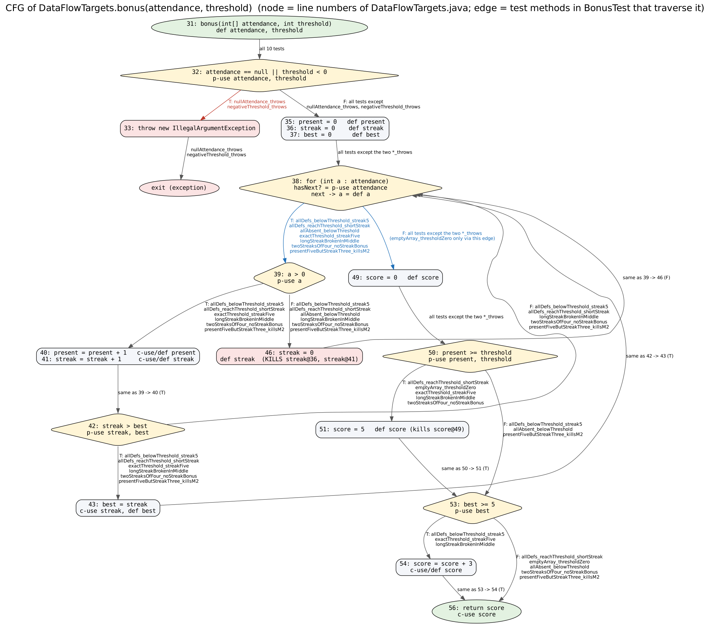

# Лаб 10: Өгөгдлийн урсгалын тест — Definition-Use хосууд

F.CSA313 — Программ хангамжийн чанарын баталгаа ба тест (2026)

- **Нэр:** С. Азжаргал
- **Оюутны код:** B232270052
- **Үйлдлийн систем:** Windows 11 (Git Bash)

### `java -version`

```
openjdk version "17.0.20.1" 2026-08-18
OpenJDK Runtime Environment Temurin-17.0.20.1+1 (build 17.0.20.1+1)
OpenJDK 64-Bit Server VM Temurin-17.0.20.1+1 (build 17.0.20.1+1, mixed mode, sharing)
```

### `mvn -version`

```
Apache Maven 3.9.16 (2bdd9fddda4b155ebf8000e807eb73fd829a51d5)
Maven home: C:\Program Files\apache-maven-3.9.16
Java version: 17.0.20.1, vendor: Eclipse Adoptium, runtime: C:\Program Files\Eclipse Adoptium\jdk-17.0.20.101-hotspot
Default locale: en_US, platform encoding: Cp1252
OS name: "windows 11", version: "10.0", arch: "amd64", family: "windows"
```

Мөрийн дугаар бүгд `src/main/java/mn/edu/must/sqat/DataFlowTargets.java` файлын дугаар.
Тестийн ID-ууд:

| ID | Класс | Метод | Оролт | Хүлээгдэх |
|---|---|---|---|---|
| G1 | GcdTest | `gcd_7_0_noIteration` | gcd(7, 0) | 7 |
| G2 | GcdTest | `gcd_12_8_twoIterations` | gcd(12, 8) | 4 |
| G3 | GcdTest | `gcd_8_4_oneIteration` | gcd(8, 4) | 4 |
| G4 | GcdTest | `gcd_0_5_oneIteration` | gcd(0, 5) | 5 |
| D1 | BonusTest | `allDefs_belowThreshold_streak5` | [1,0,1,1,1,1,1], 10 | 3 |
| D2 | BonusTest | `allDefs_reachThreshold_shortStreak` | [1,0,1], 1 | 5 |
| P1 | BonusTest | `nullAttendance_throws` | null, 3 | IAE |
| P2 | BonusTest | `negativeThreshold_throws` | [1], -1 | IAE |
| P3 | BonusTest | `emptyArray_thresholdZero` | [], 0 | 5 |
| P4 | BonusTest | `allAbsent_belowThreshold` | [0,0,0], 1 | 0 |
| P5 | BonusTest | `exactThreshold_streakFive` | [1,1,1,1,1], 5 | 8 |
| P6 | BonusTest | `longStreakBrokenInMiddle` | [1,1,1,0,1,1,1,1,1,1], 9 | 8 |
| P7 | BonusTest | `twoStreaksOfFour_noStreakBonus` | [1,1,1,1,0,1,1,1,1], 8 | 5 |
| K1 | BonusTest | `presentFiveButStreakThree_killsM2` | [1,1,0,1,1,1], 10 | 0 |

D1–D2 = all-defs шат, P1–P7 = all-DU-pairs шатанд нэмсэн, K1 = Хэсэг C-д M2-ийг унагахаар нэмсэн.

---

## Хэсэг A: gcd

Лекцийн дугаарлалтыг файлын дугаарлалт руу хөрвүүлсэн: 1→13, 3→15, 4→16, 5→17, 6→18, 8→20.

| Мөр | Def | Use |
|---|---|---|
| 13 | x, y | — |
| 14 | — (`int tmp;` зөвхөн зарлалт, утга оноогоогүй тул def биш) | — |
| 15 | — | y (p-use) |
| 16 | tmp | x, y (c-use) |
| 17 | x | y (c-use) |
| 18 | y | tmp (c-use) |
| 20 | — | x (c-use) |

### gcd-ийн бүрэн DU хүснэгт (13 хос)

| # | Хувьсагч | Def мөр | Use мөр | c/p-use | Def-clear зам | Тестийн ID | Хамрагдсан |
|---|---|---|---|---|---|---|---|
| 1 | x | 13 | 16 | c | 13→15(T)→16 | G2, G3, G4 | ✔ |
| 2 | x | 13 | 20 | c | 13→15(F)→20 | G1 | ✔ |
| 3 | x | 17 | 16 | c | 17→18→15(T)→16 | G2 | ✔ |
| 4 | x | 17 | 20 | c | 17→18→15(F)→20 | G2, G3, G4 | ✔ |
| 5 | y | 13 | (15,16) | p, T | 13→15(T) | G2, G3, G4 | ✔ |
| 6 | y | 13 | (15,20) | p, F | 13→15(F) | G1 | ✔ |
| 7 | y | 13 | 16 | c | 13→15(T)→16 | G2, G3, G4 | ✔ |
| 8 | y | 13 | 17 | c | 13→15(T)→16→17 | G2, G3, G4 | ✔ |
| 9 | y | 18 | (15,16) | p, T | 18→15(T) | G2 | ✔ |
| 10 | y | 18 | (15,20) | p, F | 18→15(F) | G2, G3, G4 | ✔ |
| 11 | y | 18 | 16 | c | 18→15(T)→16 | G2 | ✔ |
| 12 | y | 18 | 17 | c | 18→15(T)→16→17 | G2 | ✔ |
| 13 | tmp | 16 | 18 | c | 16→17→18 | G2, G3, G4 | ✔ |

Лекцид дутуу үлдсэн хосууд нь давталтын буцах ирмэгээр (18→15) дамждаг хосууд: x(17→16), y(18→15T), y(18→16), y(18→17), мөн давталт огт хийгдэхгүй үеийн x(13→20), y(13→15F). Бүх 13 хос хамрагдсан → **all-DU-pairs хангагдсан.**

### Тестүүдийн тайлбар ба асуултууд

- **gcd(7,0) ганцаараа ямар хос хамардаг вэ?** — `x(13→20)` ба `y(13→15,F)`. y = 0 үед давталт огт ажиллахгүй тул мөр 13-ын x шууд 20-р мөрийн return-д хүрнэ. Бусад тест (G2–G4) бүгд y ≠ 0-ээр эхэлдэг тул эдгээр хоёр хосыг зөвхөн G1 хамарна.
- **gcd(12,8) хэдэн давталт хийдэг вэ?** — 2 давталт: (x,y) = (12,8) → (8,4) → (4,0), үр дүн 4.
- **Аль хосууд давталт шаарддаг вэ?** Дор хаяж 1 давталт: x(13→16), x(17→20), y(13→15T), y(13→16), y(13→17), y(18→15F), tmp(16→18). Дор хаяж **2** давталт (18-р мөрийн y эсвэл 17-р мөрийн x буцаж давталтын биед хэрэглэгдэх): x(17→16), y(18→15T), y(18→16), y(18→17) — эдгээрийг зөвхөн G2 хамардаг.
- G3, G4 нь 1 давталттай тохиолдол; all-DU-pairs-д G1 + G2 хангалттай, G3/G4 нь нэмэлт баталгаа (x = 0 оролттой хил).

---

## Хэсэг B: bonus

### B1 — CFG



Зангилаа бүрд мөрийн дугаар бичсэн. For-each (мөр 38): нөхцөл = attendance-д дараагийн элемент байгаа эсэх (attendance-ийн p-use), алхам = дараагийн элементийг `a`-д оноох (`a`-ийн def). 42-ын F ирмэг, 43, 46-аас гарах ирмэгүүд 38 руу буцна. Ирмэг бүрт түүнийг дайрдаг BonusTest-ийн метод нэр бичсэн.

### B2 — Def/Use жагсаалт

```java
// 31: def attendance, def threshold
// 32: p-use attendance, p-use threshold   (attendance == null || threshold < 0)
// 33: (throw) — def/use байхгүй
// 35: def present
// 36: def streak
// 37: def best
// 38: p-use attendance (дараагийн элемент бий юу), def a (a = дараагийн элемент)
// 39: p-use a
// 40: c-use present, def present
// 41: c-use streak, def streak
// 42: p-use streak, p-use best
// 43: c-use streak, def best
// 46: def streak                (streak@36, streak@41-ийг KILL хийнэ)
// 49: def score
// 50: p-use present, p-use threshold
// 51: def score                 (score@49-ийг kill)
// 53: p-use best
// 54: c-use score, def score
// 56: c-use score               (return)
```

### B3 — DU хүснэгт

p-use-ийг салаа тус бүрээр (T/F) тусдаа хос гэж тоолсон. Шийдвэрийн зангилааны F ирмэг: 32F→35, 38F→49, 39F→46, 42F→38, 50F→53, 53F→56.

| ID | Хувьсагч | Def | Use | c/p | Def-clear зам | Тестийн ID | Хамрагдсан |
|---|---|---|---|---|---|---|---|
| B1 | attendance | 31 | (32,33) | p T | 31→32 | P1, P2 | ✔ |
| B2 | attendance | 31 | (32,35) | p F | 31→32 | D1, D2, P3–P7, K1 | ✔ |
| B3 | attendance | 31 | (38,39) | p T | 31→32→35→36→37→38 | D1, D2, P4–P7, K1 | ✔ |
| B4 | attendance | 31 | (38,49) | p F | 31→…→38 (attendance дахин def хийгддэггүй) | D1, D2, P3–P7, K1 | ✔ |
| B5 | threshold | 31 | (32,33) | p T | 31→32 | P2 | ✔ |
| B6 | threshold | 31 | (32,35) | p F | 31→32 | D1, D2, P3–P7, K1 | ✔ |
| B7 | threshold | 31 | (50,51) | p T | 31→…→50 (threshold дахин def хийгддэггүй) | D2, P3, P5, P6, P7 | ✔ |
| B8 | threshold | 31 | (50,53) | p F | 31→…→50 | D1, P4, K1 | ✔ |
| B9 | present | 35 | 40 | c | 35→…→38→39(T)→40 (эхний ирсэн өдөр хүртэл) | D1, D2, P5–P7, K1 | ✔ |
| B10 | present | 35 | (50,51) | p T | 35→…→38(F)→49→50 эсвэл 39(F)-ээр л давтах | P3 | ✔ |
| B11 | present | 35 | (50,53) | p F | ижил, ирсэн өдөр нэг ч байхгүй | P4 | ✔ |
| B12 | present | 40 | 40 | c | 40→41→42→(43)→38→39(T)→40 (46 нь present-ийг kill хийдэггүй) | D1, D2, P5–P7, K1 | ✔ |
| B13 | present | 40 | (50,51) | p T | 40→…→38(F)→49→50 | D2, P5, P6, P7 | ✔ |
| B14 | present | 40 | (50,53) | p F | 40→…→38(F)→49→50 | D1, K1 | ✔ |
| B15 | streak | 36 | 41 | c | 36→37→38→39(T)→40→41 (эхний элемент > 0) | D1, D2, P5–P7, K1 | ✔ |
| B16 | streak | 41 | (42,43) | p T | 41→42 | D1, D2, P5–P7, K1 | ✔ |
| B17 | streak | 41 | (42,38) | p F | 41→42 | D1, D2, P6, P7, K1 | ✔ |
| B18 | streak | 41 | 43 | c | 41→42(T)→43 | D1, D2, P5–P7, K1 | ✔ |
| B19 | streak | 41 | 41 | c | 41→42→(43)→38→39(T)→40→41 (дараалсан ирсэн 2 өдөр) | D1, P5, P6, P7, K1 | ✔ |
| B20 | streak | 46 | 41 | c | 46→38→39(T)→40→41 (тасалсны дараа ирсэн) | D1, D2, P6, P7, K1 | ✔ |
| B21 | best | 37 | (42,43) | p T | 37→38→39(T)→40→41→42 | D1, D2, P5–P7, K1 | ✔ |
| B22 | best | 37 | (42,38) | p F | — | — | ✘ биелэшгүй |
| B23 | best | 37 | (53,54) | p T | — | — | ✘ биелэшгүй |
| B24 | best | 37 | (53,56) | p F | 37→38(F)→49→50→(51)→53 (эсвэл зөвхөн 39F) | P3, P4 | ✔ |
| B25 | best | 43 | (42,43) | p T | 43→38→39(T)→40→41→42 | D1, P5, P6, P7, K1 | ✔ |
| B26 | best | 43 | (42,38) | p F | 43→38→39(F)→46→38→39(T)→40→41→42 | D1, D2, P6, P7, K1 | ✔ |
| B27 | best | 43 | (53,54) | p T | 43→…→38(F)→49→50→(51)→53 | D1, P5, P6 | ✔ |
| B28 | best | 43 | (53,56) | p F | 43→…→53 | D2, P7, K1 | ✔ |
| B29 | a | 38 | (39,40) | p T | 38→39 | D1, D2, P5–P7, K1 | ✔ |
| B30 | a | 38 | (39,46) | p F | 38→39 | D1, D2, P4, P6, P7, K1 | ✔ |
| B31 | score | 49 | 54 | c | 49→50(F)→53(T)→54 | D1 | ✔ |
| B32 | score | 49 | 56 | c | 49→50(F)→53(F)→56 | P4, K1 | ✔ |
| B33 | score | 51 | 54 | c | 51→53(T)→54 | P5, P6 | ✔ |
| B34 | score | 51 | 56 | c | 51→53(F)→56 | D2, P3, P7 | ✔ |
| B35 | score | 54 | 56 | c | 54→56 | D1, P5, P6 | ✔ |

**Нийт: 35 хос, 33 хамрагдсан, 2 биелэшгүй → биелэх боломжтой бүх хосын хувьд all-DU-pairs хангагдсан.**

#### Kill (дахин тодорхойлолт) тэмдэглэгээ

- **Мөр 46 `streak = 0`** нь дараах def-үүдийг KILL хийнэ:
  - `streak@36` — эхний элемент 0 байвал 36-ийн утга 41-д хүрэхгүй (зам 36→38→39F→46).
  - `streak@41` — өмнөх цувааны утга тасалсан өдөр устаж, дараагийн 41 нь 46-ийн утгыг ашиглана.
- Бусад kill: 41 нь streak@36/өмнөх streak@41-ийг; 40 нь present@35-ийг; 43 нь best@37-ийг; 51 нь score@49-ийг; 54 нь score@49 / score@51-ийг kill хийнэ.

#### Def-clear замгүй тул DU хос гэж ТООЦООГҮЙ хослолууд

- `streak@36 → 42`, `streak@36 → 43` — 36-аас 42/43 хүрэх ямар ч зам заавал 41-ээр (streak-ийн шинэ def) дамжина.
- `streak@46 → 42`, `streak@46 → 43` — мөн 41-ээр kill болно.
- `streak@46 → 46`, `streak` нь давталтын дараа хэрэглэгддэггүй тул 46-аас өөр use байхгүй.
- `score@49 → 54/56` хосууд 51-ээр дамжих замаараа kill болдог ч 50(F) замаар def-clear тул хос (B31, B32) хэвээр тоологдсон.

#### Биелэшгүй хосын үндэслэл

- **B22 best(37→42, F):** best@37 = 0 хэвээр 42-т хүрэх үед streak нь 41-д нэмэгдээд ≥ 1 байдаг тул `streak > best` үргэлж үнэн — эхний 42 үргэлж T, тэр даруй 43 best-ийг дахин тодорхойлно.
- **B23 best(37→53, T):** best@37 53-д хүрэх нь 43 хэзээ ч ажиллаагүй (ирсэн өдөр байхгүй) гэсэн үг, тэгвэл best = 0 бөгөөд `0 >= 5` хэзээ ч үнэн биш.

### B4 — Хоёр шатны тест

**ALL-DEFS: хамгийн цөөндөө 2 тест** (D1, D2).

Үндэслэл: `score`-ийн def@49 ба def@51 нь мөр 50-ийн эсрэг хоёр салаан дээр байна. score@49 ямар нэг use-д (54 эсвэл 56) хүрэхийн тулд 50 **F** байх ёстой (T бол 51 түүнийг kill хийнэ); score@51 бүр гүйцэтгэгдэхийн тулд 50 **T** байх ёстой. Нэг гүйцэтгэлд 50 зөвхөн нэг удаа шалгагддаг тул нэг тест хоёуланг нь хангах боломжгүй → 1 тест хангалтгүй.

2 тест хангалттай нь:
- D1 `[1,0,1,1,1,1,1], 10` (50F, 53T): score@49→54, score@54→56, streak@36→41, streak@41→42, streak@46→41, present@35→40, present@40→50, best@37→42, best@43→53, a@38→39, attendance/threshold@31→32.
- D2 `[1,0,1], 1` (50T): score@51→56.

Бүх def (attendance, threshold@31; present@35,40; streak@36,41,46; best@37,43; a@38; score@49,51,54) дор хаяж нэг use-д хүрсэн. Энэ шатанд хамрагдаагүй хосууд: B1, B5, B10, B11, B24, B32, B33 (+ биелэшгүй B22, B23) → P1–P7 тестүүдээр нөхсөн.

### B5 — JaCoCo

| Үе шат | Файл | Tests run | BRANCH missed / covered | LINE missed / covered |
|---|---|---|---|---|
| All-defs (G1–G4, D1–D2) | `results/jacoco-alldefs.csv` | 6 | 2 / 14 (14/16) | 2 / 22 |
| Эцсийн (Хэсэг C-гийн дараа) | `results/jacoco-final.csv` | 14 | 0 / 16 (16/16) | 1 / 23 |

- LINE_MISSED = 1 нь мөр 7-ийн далд constructor `DataFlowTargets()` — зааврын дагуу хэвийн.
- **all-defs хангагдсан ч branch 100% биш байж болох уу?** — Тийм. all-defs үед branch 14/16: мөр 32-ын `attendance == null` ба `threshold < 0` хоёрын T салаа (exception) хамрагдаагүй, мөр 33 ч ажиллаагүй (LINE_MISSED 2). all-defs нь def бүрийг *ямар нэг* use-д хүргэхийг л шаардах тул p-use-ийн бүх салааг шаарддаггүй.
- **Branch 100% болсон ч DU хос үлдэж болох уу?** — Тийм. Жишээ: bonus-ийн тест багц {P1, P2, P3, P4, P5, P6} (+ gcd-ийн G1, G2) нь 16/16 branch-ийг бүгдийг хамарна (32-ын 4 салаа, 38/39/42/50/53-ын T ба F). Гэвч энэ багцад 50**F** ба 53**T** нэг гүйцэтгэлд хамт гардаг тест алга (P4: 50F/53F, P5, P6: 50T/53T) тул **B31 score(49→54)** хос хамрагдахгүй; мөн 43-т тодорхойлогдсон best 53-ын F салаанд хүрдэг тест байхгүй тул **B28 best(43→53F)** хамрагдахгүй. Branch хамралт нь ирмэг тус бүрийг тусад нь тоолдог, харин DU хос нь def-ээс use хүртэлх *замын хослолыг* шаарддаг — тиймээс branch 100% нь all-DU-pairs-ийг баталгаажуулдаггүй.

---

## Хэсэг C: Fault seeding

| № | Мутаци | Tests run / Failures | Унасан тест | expected / was | Үр дүн |
|---|---|---|---|---|---|
| M1 | 41-р мөр `streak = streak + 1;` устгасан | 13 / 3 | `allDefs_belowThreshold_streak5`<br>`exactThreshold_streakFive`<br>`longStreakBrokenInMiddle` | expected: <3> but was: <0><br>expected: <8> but was: <5><br>expected: <8> but was: <5> | Баригдсан (killed) |
| M2 | 43-р мөр `best = streak;` → `best = present;` | 13 / 0 | — | — | **АМЬД үлдсэн** |
| M2-kill | M2 хэвээр, K1 тест нэмсэн | 14 / 1 | `presentFiveButStreakThree_killsM2` | expected: <0> but was: <3> | K1 баригдсан |
| M3 | 48-р мөрийн дараа `int total = present + best;` | 14 / 0 | — | — | Амьд (тест барих боломжгүй) |

Эх файлууд: `results/mvn-test-M1.txt`, `results/mvn-test-M2.txt`, `results/mvn-test-M2-kill.txt`, `results/mvn-test-M3.txt`. Мутаци бүрийн дараа `git restore src/main/java/mn/edu/must/sqat/DataFlowTargets.java` хийсэн, мутаци commit хийгдээгүй.

**M1:** streak хэзээ ч өсөхгүй (0 хэвээр) тул 42 үргэлж F, best = 0 үлдэж +3 оноо хэзээ ч өгөгдөхгүй. best ≥ 5 хүлээдэг гурван тест шууд унасан.

**M2 яагаад all-DU-pairs-ийг давсан бэ?** best шинэчлэгдэх мөчид (42 T) мутант `present`-ийг, эх код `streak`-ийг онооно. present ≥ streak үргэлж тул мутантын best ≥ жинхэнэ best. Үр дүн зөвхөн мутантын best ≥ 5 боловч жинхэнэ хамгийн урт цуваа < 5 байх үед л өөрчлөгдөнө. Манай тестүүдэд:
- D1, P5, P6-д жинхэнэ best аль хэдийн ≥ 5 тул +3 оноо хоёуланд нь ижил;
- D2-д present ≤ 2;
- P7-д хоёр дахь 4-ийн цуваа best = 4-ийг давахгүй (42 F) тул best шинэчлэгдэхгүй, present = 8 байсан ч хэрэглэгдээгүй.

Өөрөөр хэлбэл streak@41→43 хос (B18) хамрагдсан ч, тэр мөчид present ба streak-ийн *утга* ялгаатай, мөн тэр ялгаа гаралтад нөлөөлөх нөхцөл нэг ч тестэд бүрдээгүй. DU хамралт нь замыг шалгадаг болохоос утгыг шалгадаггүй.

**M2-ийг унагасан тест K1** `[1,1,0,1,1,1], 10`: эхний цуваа best = 2; дараагийн цуваа 3 болоход (streak 3 > best 2) present = 5 байна. Эх код: best = 3 → 0 оноо. Мутант: best = present = 5 → +3 оноо. `expected: <0> but was: <3>`.

**M3 яагаад ямар ч тест унагаагүй вэ?** `total` гэсэн def-д нэг ч use байхгүй (DU хосгүй "үхсэн def", dd/du гажилт) — програмын гаралтад огт нөлөөлөхгүй тул ямар ч тест, ямар ч хамралтын хэмжүүр (branch, DU) үүнийг илрүүлэхгүй; javac ч анхааруулдаггүй. Үүнийг **статик анализ** (IDE-ийн шалгагч, PMD `UnusedLocalVariable`, SpotBugs `DLS_DEAD_LOCAL_STORE`, SonarLint) барих ёстой. IDE-ийн анхааруулга:

```
The value of the local variable total is not used   [VS Code, Java(536870973)]
```

Эцсийн байдал: `git status`-д `DataFlowTargets.java` өөрчлөгдсөн гэж гараагүй; `results/mvn-verify-final.txt` — Tests run: 14, Failures: 0; `results/jacoco-final.csv` — BRANCH_MISSED = 0 (16/16).

---

## Дүгнэлт

DU анализ нь branch хамралтаас илүү нарийн: branch нь ирмэг бүрийг тусад нь тоолдог бол DU хос нь утга хаана тодорхойлогдож, хаана хүрч хэрэглэгддэгийг шалгадаг тул branch 16/16 болсон ч score(49→54) мэт хослол хамрагдаагүй үлдэж болохыг харлаа. Мөн DU анализ нь kill, биелэшгүй хос, үхсэн def (M3) зэрэг урсгалын гажилтыг илрүүлэх хэлийг өгдөг. Гэвч энэ нь үнэтэй: JaCoCo DU хамралтыг хэмждэггүй тул бүх хос, def-clear зам, хамрагдалтыг гараар тооцох шаардлагатай бөгөөд давталттай функцэд замын тоо хурдан өсдөг. DU хамралт 100% ч гэсэн M2 шиг утгын алдааг баталгаатай барихгүй — хос хамрагдсан ч хувьсагчийн утга ялгаатай байх нөхцөл тестэд бүрдэхгүй байж болно. Хамгийн их цаг авсан алхам нь bonus-ийн DU хүснэгт (B3): for-each давталт, 46-р мөрийн kill болон биелэшгүй хосыг ялгаж, хос бүрийн def-clear замыг шалгах.

## AI туслах ашигласан байдал

Claude (Anthropic) AI туслахыг дараах зүйлд ашигласан: GcdTest/BonusTest тестийн ноорог, DU хүснэгтийн хос бүрийг аль тест хамарч буйг шалгах (кодын мөр бүрийн def/use-ийг Python скриптээр trace хийж харьцуулсан), cfg-bonus.png-ийг Graphviz-ээр үүсгэх, README-ийн бүтэц. Тестүүдийг өөрийн Windows машин дээр ажиллуулж, results/ доторх бүх гаралтыг өөрөө үүсгэсэн; README-ийн тоонуудыг results/ файлуудтай тулгаж шалгасан.